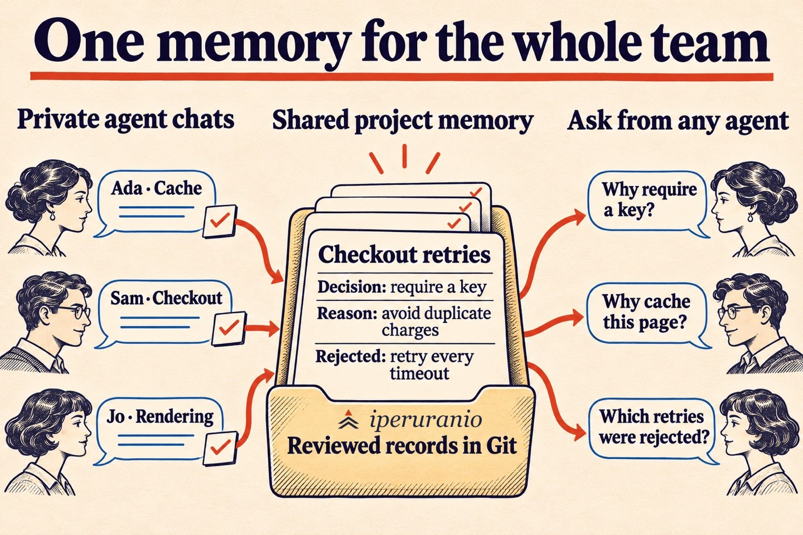
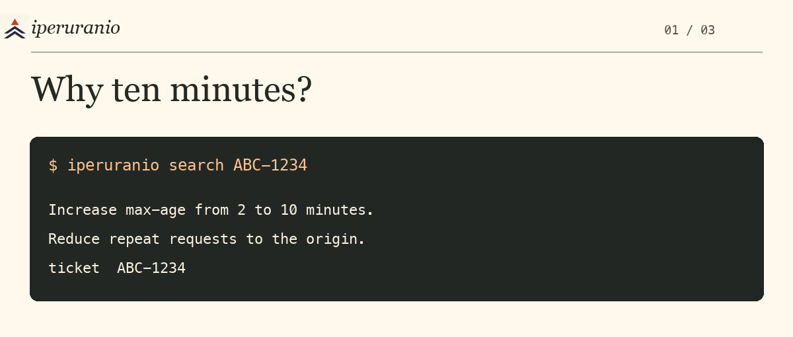
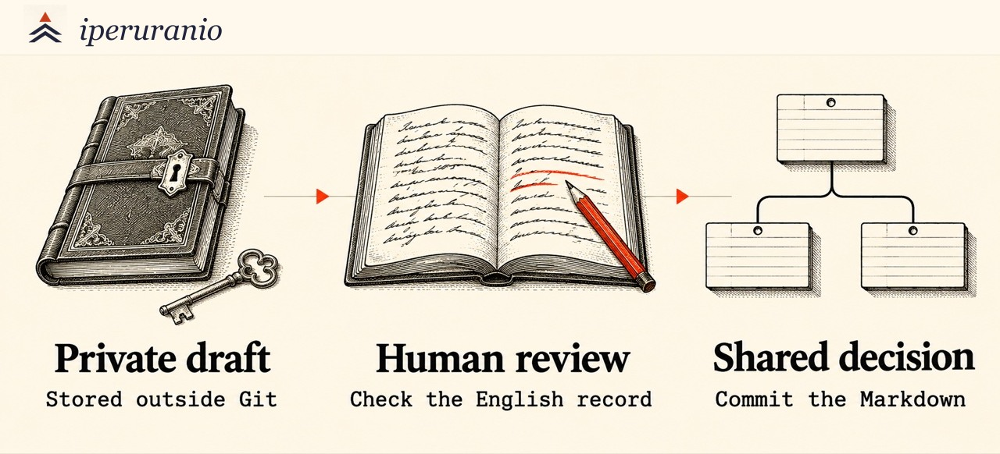
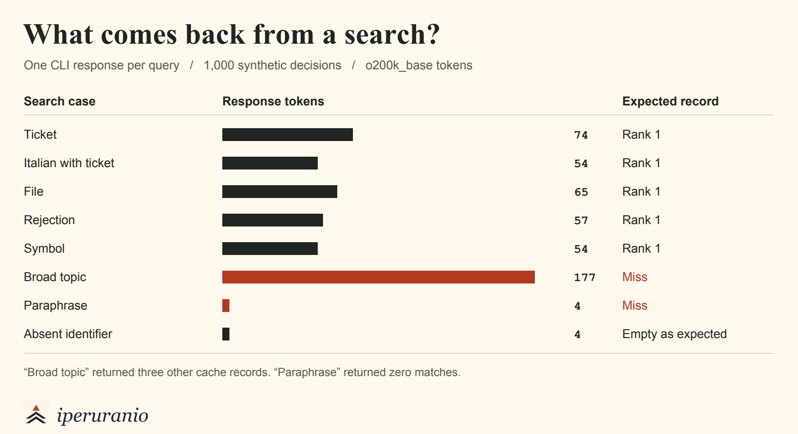

#  iperuranio

**Shared memory for teams that build with coding agents.** Your team already shares the code through Git. The reason for a change can still live in one developer’s chat. With iperuranio, a developer can review that decision, commit it alongside the code and make it discoverable from a teammate’s next agent session.

[How the team shares memory](#how-the-team-shares-memory) · [Try it](#try-it) · [Agent skill](#use-iperuranio-as-an-agent-skill) · [Privacy](#what-leaves-the-chat) · [Benchmark](#search-benchmark)


## How the team shares memory

Every developer can contribute to the team’s iperuranio archive, one reviewed decision at a time. Ada’s conversations about caching, Sam’s about checkout and Jo’s about rendering all add to the history that travels with the branch.



Take Sam’s checkout decision. After a timeout, a payment might already have succeeded. Sam and his agent considered retrying every request, then decided to require an idempotency key to avoid a duplicate charge. His reviewed record preserves all three pieces: **what they chose, why, and what they ruled out**.

Weeks later, Ada can ask her agent why checkout needs that key. Jo can ask which retry policy the team rejected. Once they pull the record, both can find the answer in their own checkout. Their next decisions can go back into the same archive. The original conversations stay private.

## Try it

From a Git project with Node 24+ and a POSIX shell:

```sh
npm install --save-dev github:lollegp/iperuranio
npx --no-install iperuranio init
```

Plain `init` installs the runtime in the project and adds a memory workflow to `AGENTS.md`. Each developer enrolls their checkout. Choose the integration your agent can use:

| Agent capability | Setup | What works |
| --- | --- | --- |
| Run shell commands | `iperuranio init` or `iperuranio init my-agent`. Point the agent at `AGENTS.md` if it uses a different instructions file. | Search, read history, stage decisions and handoffs through the project CLI. |
| Launch a local stdio MCP server | Register the `command` and `args` in the `mcp` object printed by init as the server named `iperuranio`. Keep that machine-specific descriptor in the client's local settings. | All six memory tools. The launcher stays bound to the chosen checkout even if the IDE starts it elsewhere. |
| Installed hook adapter | Run `iperuranio init AGENT`, choosing `cursor`, `gemini-cli`, `codex`, `claude-code` or `copilot-cli`. Inspect the generated settings, restart the client and enable project trust. | Project MCP setup, skill and automatic capture on supported events. |
| Read repository files only | Open the reviewed Markdown under `.iperuranio/decisions/` in the checkout. | Read shared decisions directly. |

Use `npx --no-install iperuranio` for the installed local executable in the examples. CLI and MCP calls stage decisions when the agent invokes them. To capture messages independently of the agent's tool choices, use a native adapter or map the host’s events to the bridge below.

<details>
<summary>Connect a custom agent’s message events</summary>

Enroll a stable name, for example `iperuranio init team-agent`. Have the host run `node .iperuranio/runtime/cli.ts hook team-agent message` from the checkout and write one JSON object per invocation to stdin:

```json
{"cwd":"/absolute/path/to/the/checkout","role":"user","text":"We decided to require an idempotency key for retries."}
```

Use `user` for a submitted prompt and `assistant` for the final response. Send the message at delivery time so capture can survive an abandoned chat. The bridge checks the enrolled project, applies the same privacy rules as the built-in adapters and ignores transcript paths. CLI-only and MCP-only hosts without message events rely on explicit tool calls. A host without shell, stdio MCP or file access needs its own integration.

Cursor uses `beforeSubmitPrompt` and `afterAgentResponse` in single-root workspaces. Gemini CLI uses `BeforeAgent` and `AfterAgent`. These adapters process delivered messages; transcript replay remains specific to the original three adapters. [Cursor hooks](https://cursor.com/docs/hooks) · [Gemini CLI hooks](https://geminicli.com/docs/hooks/reference/)

</details>

<details>
<summary>Save and find your first decision</summary>

```sh
npx --no-install iperuranio save "Increase max-age from 2 to 10 minutes." \
  --reason "Reduce repeat requests to the origin." --ticket ABC-1234
npx --no-install iperuranio review CANDIDATE_ID
npx --no-install iperuranio search ABC-1234
```

Replace `CANDIDATE_ID` with the ID from `save`. Check the English Markdown and type `PUBLISH` to write it to `.iperuranio/decisions/`. Commit and push the reviewed file with your next change so teammates can find it too.

</details>

## Use iperuranio as an agent skill

Install the [iperuranio skill](skills/iperuranio/SKILL.md) directly from GitHub. Run this in your project and select the coding agent that should use it:

```sh
npx skills add lollegp/iperuranio --skill iperuranio
```

The skill provides the multi-agent workflow and can read reviewed Markdown without the iperuranio runtime. If your project already has the iperuranio package installed, you can use its built-in installer instead:

```sh
npx --no-install iperuranio skill install
```

This installs `.agents/skills/iperuranio/SKILL.md` in the repository. Pass the same host ID used by `init` (for example `skill install claude-code`) to select its project skill directory. A native `init` already installs the skill. A portable `init` puts the workflow in `AGENTS.md` for clients that use repository instructions. For agents with their own skill installer, import the `skills/iperuranio` directory from this package. Reload the agent's skill list if needed.

Choose **skill only** to guide agents and consult existing reviewed Markdown. Choose **init** when you also want the runtime for search, private candidates, review and supported hooks. The skill installer changes only the project's skill file.

For example, give the coordinating agent this task:

> Use the iperuranio skill for ABC-1234. Find the current cache decision and pass its record ID to the implementation and review agents. Have the reviewer check the rationale against the branch and test results. Stage one handoff with the changed files, verified outcome and any open question for the next developer.

Workers can follow the same [workflow](skills/iperuranio/SKILL.md) directly when their host lacks skill discovery. The receiving agent can resolve a reviewed record ID in a checkout that contains the commit. Until then, pass authorized findings directly in the task handoff.

## One ticket, two decisions

> “Why did we pick ten minutes? I’m looking at the code and it says five.”

In the sample project, the answer spans two tickets:

| Ticket | Change | Recorded reason |
| --- | --- | --- |
| `ABC-1234` | 2 min → 10 min | Reduce repeat requests to the origin. |
| `ABC-1250` | 10 min → 5 min | Product information stayed stale after updates. |

A search for the **old ticket** returns its rationale and a `supersededBy` ID. Follow that ID to read the second decision. This demo uses actual CLI results from a temporary checkout, condensed for readability.



## What leaves the chat?



Hooks look for decision-related text during a conversation, so you can close a chat without remembering a final save command. On the next session, iperuranio can replay unread entries if the host retained a supported transcript. Capture depends on the events the host delivers and currently handles messages up to 12,000 characters.

Drafts live outside Git, under `~/.local/state/iperuranio/<checkout-hash>/`. They can contain sensitive material. The original transcript follows the coding agent’s own retention settings. Filters catch common credential formats and email addresses; the reviewer checks names, confidential details and whether the wording still reflects the discussion. Anyone with read access to the repository can read a committed record. Terminal approval assumes a trusted local user.

## Search benchmark

In a checkout with **1,000 synthetic decisions**, a lookup for `ABC-1234` returned the original rationale and its replacement ID in **74 tokens**. The Markdown files contained 37,790 tokens altogether. The CLI read them locally and returned one match.

Lexical search ranked the intended record first for five of seven queries with a known target. A broad search for `cache` found three other cache decisions. The phrase `freshness window` missed entirely. An eighth query for an unknown symbol correctly returned an empty result.



<details>
<summary>Timings, archive sizes and reproduction steps</summary>

| Synthetic records | Whole archive (tokens) | Successful response (median tokens) | CLI median | CLI p95 |
| ---: | ---: | ---: | ---: | ---: |
| 50 | 1,880 | 57 | 198 ms | 374 ms |
| 250 | 9,440 | 57 | 208 ms | 223 ms |
| 1,000 | 37,790 | 57 | 411 ms | 434 ms |

Measured on one Apple M4 with Node 24.20.0 and local inference disabled. Each size includes 40 timed CLI calls after warm-up. Latency includes process startup. The token count uses `o200k_base` on the JSON response. Follow-up reads and agent messages cost extra. Run `npm ci` and `npm run benchmark` in the source checkout to repeat the experiment. [Method and fixtures](benchmark/search.mjs) · [Per-query measurements](benchmark/results.json)

</details>

## Configuration and commands

<details>
<summary><strong>Multilingual teams and local inference</strong></summary>

Teams can discuss a change in their own language and review records in English. By default, hooks recognize decision-related phrases and the agent skill asks for structured English drafts. Local search includes a small multilingual vocabulary.

For broader extraction and query translation, run a trusted offline server on your machine with an OpenAI-compatible chat completions endpoint and model alias `local`. Add `--model-port 8080` to `init`. This authorizes eligible private segments for that server. Disable logging and remote forwarding there. A second inference call checks the English claims against the source. The developer reviews the result for omissions and changes in meaning. Failed extraction stays queued for `iperuranio drain`.

</details>

<details>
<summary><strong>CLI, agent tools and storage options</strong></summary>

Use these commands through `npx --no-install iperuranio` or the project-local `node .iperuranio/runtime/cli.ts`.

| Task | Command |
| --- | --- |
| Find a choice concerning a file | `search "render" --file src/List.tsx` |
| Inspect a decision and its history | `show RECORD_ID` and `history RECORD_ID` |
| Record why an alternative was discarded | `forget "Use a 30-minute cache" --reason "Updates stayed stale too long."` |
| Replace an earlier choice | `save "Reduce max-age to 5 minutes." --supersedes RECORD_ID` |
| Return to an unfinished review | `pending` and `review CANDIDATE_ID` |

Agents can search, save candidates, retrieve handoffs and challenge a decision through the local MCP server. Scripts can pass JSON to `save --stdin` with fields such as `text`, `reason`, `source` and `ticket`. An empty result means the search found no matching record in this checkout.

To change the archive location, pass `--history-dir docs/memory` on first initialization. One opt-in rule, `--auto-cache`, writes a record automatically for an explicit user sentence matching “Decision: change max-age from 2 to 10 minutes” or its Italian equivalent with integer values. Enable it only when that fact is suitable for everyone who can read the repository. Other free text requires review.

</details>

## Development

Run `npm ci` and `npm run check` from the iperuranio source checkout (`nvm use` selects Node 24). The check runs Oxlint and tests against temporary Git repositories and synthetic conversations. Hook delivery in a particular client version, IDE integration and translation quality with your model need testing in your environment.
